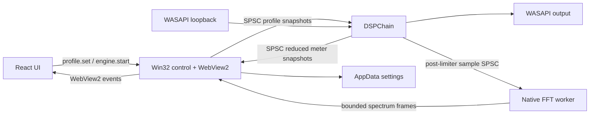

# Architecture — foundation 0.1

The portable C++23 domain (`Profile`) describes parameters without Windows or React dependencies. `AudioProcessor` consumes interleaved float32 views into owned, prepared buffers. DSP depends only on domain/core. The WASAPI adapter owns COM clients, OS handles and a DSPChain. The Win32/WebView2 host translates JSON messages into domain values and persists settings. React renders settings and telemetry; it never processes audio.

## Thread ownership

- Main/UI control thread: WebView2, JSON, device listing, settings files, parameter queue producer and analyzer queue consumer.
- Dedicated audio worker: MTA COM, event wait, WASAPI capture/render, DSP, parameter queue consumer and analyzer queue producer.
- Independent analyzer worker: consumes bounded raw-sample blocks, runs Hann/radix-2 FFT and smoothing, and produces bounded spectrum frames.
- Browser compositor handles decorative CSS animations; requestAnimationFrame draws native spectrum bins on canvas without FFT work.

Prepare and stop are outside callbacks; start preallocates scratch/FIFO/filter state. Steady-state processing performs no heap allocation, file I/O, JSON, synchronous logging or mutex acquisition. Exceptions occur on WASAPI failures; the worker then unwinds and reports a control-thread-readable error. This is a soft realtime user-mode engine, not a guarantee of Windows scheduling deadlines.

SPSC queues reject rather than overwrite unread data. Control queue capacity is 15 profiles; UI coalesces changes for 25 ms. Meter snapshot queue holds seven snapshots; host drains to the latest at ~30 Hz. Spectrum sample/frame queues are separate and bounded, as detailed in the analyzer documentation. Queue producers must not be called concurrently. `setBypass` is an audio-thread operation; the host uses queued whole profiles instead.

## IPC v1

Requests: `devices.list`, `settings.load`, `settings.save {value}`, `profile.set {profile}`, `engine.start {sourceId, outputId}`, `engine.stop`.
Events also include `spectrum` and `spectrum.status` at ~30 Hz; see [spectrum-analyzer.md](spectrum-analyzer.md) for the payload and thread contract.

Existing events: `devices {devices}`, `settings {value}`, `status {sourceId, outputId, running, underruns, overruns, glitches, bufferMs, callbackMs, error}`, `analyzer {peakL, peakR, rmsL, rmsR, reductionDb, waveform}`, `error {message}`. No heavy UI polling: only an inexpensive native telemetry timer posts events.

WebView2 maps bundled UI to `https://miyazato.local`. Host rejects messages from other origins. JSON parsing errors are surfaced. UI settings use version 1 and validate numeric ranges; persistence writes a temporary file then replaces the destination. Profile data is not authoritative DSP code.

## Extension boundaries

HRTF and upmix must be added as actual processors, prepared outside the callback, with explicit channel maps and verified dataset licensing. APO integration can reuse portable DSP but requires a different Windows adapter and realtime contract. A future worker should own enumeration/recovery/persistence independently from UI control. Add asynchronous logging with bounded POD records before implementing file log sinks; no synchronous callback logger exists here.
