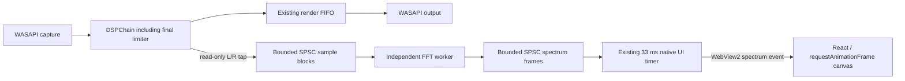

# Native FFT spectrum analyzer

The live data path is implemented from the WASAPI adapter to the existing
WebView2 bridge and React canvas. Portable native and frontend tests validate
its parts. This Linux workspace cannot build or run the Windows host, so live
WASAPI/WebView2 listening validation remains pending. Browser checks use native
FFT results from generated test signals through a test-only bridge shim; they
are not a Windows listening test.

## Signal and thread ownership



The tap is immediately after `chain_.process(view)` in
`engine/audio/wasapi/LoopbackEngine.cpp`, after the sample-peak limiter and before
render FIFO handling. It observes processed capture samples. Render-side inserted
silence on underrun, FIFO losses, device volume, and the DAC are outside this tap.
It does not analyze the existing decimated waveform snapshots.

The audio producer only reads samples, copies combined `(L + R) / 2` values into
fixed sample blocks, and updates a dropped-block atomic. No FFT, allocation,
mutex, wait, JSON, IPC, or logging occurs in the tap. The original DSP algorithm,
profile values, render operations, and peak/RMS/reduction snapshots are unchanged.
Opposite-phase left/right components can cancel in this combined spectrum.

The sample SPSC queue reuses `engine/core/SpscQueue.h`: 65 slots hold at most
64 blocks of 256 mono samples (16,384 samples, about 341 ms at 48 kHz). Partial
blocks carry a valid sample count. Each block has a sample position; gaps caused
by drops reset the worker window rather than splicing discontinuous samples.
Full queues reject new analyzer data without waiting or overwriting unread data.
The worker drains at most 64 blocks per iteration and analyzes the latest complete
window in its history. Its frame queue holds three unread frames. A session
generation prevents old frames from appearing after restart, while preserving
single-consumer ownership during concurrent UI reads.

Lifecycle setup/shutdown is serialized outside steady-state audio processing.
The previous worker is joined before its buffers are prepared for a new sample
rate. Worker setup/allocation/thread-creation and recoverable worker failures are
contained and only make analysis unavailable. UI delivery failures are contained
in the optional spectrum telemetry block. No analyzer failure stops the audio
route. Fatal process failures are outside this recoverable-error contract.

## FFT, window, and levels

`engine/dsp/analyzer/SpectrumAnalyzer.{h,cpp}` implements an iterative radix-2
Cooley–Tukey FFT, O(N log N), without a new FFT dependency. `SpectrumConfig` defaults
to 2048 samples and supports 1024, 2048, 4096, and 8192 for future native configuration.
There is no new user-facing audio setting or preset parameter.

Preparation allocates history, ordered input, window coefficients, bit-reversal
indices, twiddles, FFT scratch, and magnitude storage. The worker hot path uses
these buffers and fixed-size snapshots, with no per-analysis heap allocation.

Each transform sanitizes nonfinite values in its own scratch, removes the Hann-weighted block
mean, and applies a periodic Hann window:

`w[n] = 0.5 - 0.5 cos(2πn/N)`.

One-sided magnitudes are normalized by the actual window sum, doubled except at
DC/Nyquist, and converted using `20 log10(max(magnitude, 1e-12))`. A bin-centered
full-scale sine reads 0 dBFS peak amplitude; a half-scale sine reads approximately
−6.02 dBFS. Off-bin tones exhibit Hann scalloping. Display values are clamped to
−90…0 dBFS by default. These are spectral peak amplitudes, not band-integrated
power, LUFS, true peak, or calibrated sound-pressure measurements.

## Frequency bins and smoothing

64 display bands have equal logarithmic width from 20 Hz to
`min(20,000 Hz, sampleRate / 2)`. Bands containing FFT bins use the maximum measured
linear magnitude in their range. Sub-resolution bands interpolate neighboring
measured linear magnitudes at the geometric band center; this does not increase
native FFT resolution. At 48 kHz, a 2048 FFT resolves about 23.44 Hz per FFT bin.

Native dB values use elapsed-time exponential attack/release smoothing: 40 ms
attack, 250 ms release by default. The worker targets 60 iterations/second, capped
by configuration at 100. It only analyzes after new samples and a full window;
missed deadlines are skipped instead of producing catch-up FFT bursts. Silence
has a measured floor target and decays naturally, with no fake motion.

## IPC and canvas

The existing 33 ms Win32 telemetry timer drains the latest frame and sends at most
one spectrum event per tick, approximately 30 Hz. Events are additive; existing
requests, settings, profiles, and meter events are unchanged. C++ sends technical
numbers only:

- `spectrum`: sequence, steady-clock millisecond timestamp, FFT size, sample rate,
  frequency bounds, floor, 64 dB bins, compute time, actual analysis update rate,
  dropped sample-block count, and dropped frame count.
- `spectrum.status`: availability and paused state when the engine is stopped or
  analysis is unavailable.

Frames older than one second are not sent as live telemetry. JSON serialization
and WebView2 calls happen only on the native UI thread.

`SpectrumAnalyzer.tsx` subscribes to those events independently of the existing
peak/RMS React state. It validates payloads and stores the latest frame in a ref;
only status/format changes update component state. A memoized canvas renderer
uses requestAnimationFrame, targeting at most approximately 60 FPS, with a 24 ms
presentation transition. A ResizeObserver caches dimensions and style, and DPR
is capped at 3. Unsupported ResizeObserver environments use a size-check fallback.
After one second without fresh frames, the status becomes unavailable and bars
clear with a 250 ms time constant. Native pause/failure clears the target promptly.
Canvas failure never affects playback. Cleanup cancels animation and subscriptions.

Bar X positions are uniform because their native bands are logarithmic. Frequency
labels use actual logarithmic coordinates; the crowded 10 kHz label is staggered
vertically to avoid overlapping the 20 kHz endpoint on narrower plots.

The old static pattern remains a clearly labeled browser/initial-paused/awaiting-data fallback.
It is hidden only after a validated native FFT frame can be rendered. It never
animates or receives a LIVE label. After a live frame, native paused views clear; unavailable views always clear instead
of pretending to measure sound. Status, accessibility labels, and spectrum/FFT/
dBFS help are localized in en, pt-BR, es, and ja.

## Performance and tests

`SpectrumFrame` instruments FFT/window/bin computation time, observed analysis
cadence, and dropped input/output counters without logging from audio callbacks.
A Release GCC 11 Linux benchmark of 10,000 warmed-up 2048-sample analyses measured
about 0.144 ms CPU and 0.157 ms wall time per analysis. At 60 Hz, that FFT-core CPU
measurement projects to about 0.87% of one core, excluding audio copying,
scheduling, IPC, and drawing. It is not a measured total Windows application CPU
percentage or a guarantee for typical desktops. The 1–2% analyzer target still
needs a Windows workload measurement.

Native tests cover 100/440/1000/5000/10000 Hz sines, dual tones, silence/DC,
Hann amplitude normalization, invalid input/configuration, future FFT sizes,
Nyquist/rate changes, real worker publication, anti-phase stereo, saturation,
session restart with a concurrent UI consumer, and bit-for-bit preservation of
both tap input and the complete DSP output with analysis enabled/overflowed/stopped.
Frontend tests cover native frames, silence, truthful fallback/live states,
stale/unavailable/paused data, rate changes, malformed payloads, canvas failure,
cleanup, logarithmic positions, independent bars, and localized open help/status.

Portable Debug/Release and AddressSanitizer/UndefinedBehaviorSanitizer builds can
be run on Linux. The existing Windows CI workflow builds both configurations and
now includes the analyzer test executable through CMake. Required Windows commands:

```powershell
cmake --build build-windows-vs2026 --config Debug
ctest --test-dir build-windows-vs2026 -C Debug --output-on-failure
cmake --build build-windows-vs2026 --config Release
ctest --test-dir build-windows-vs2026 -C Release --output-on-failure
```

On Windows, validate silence, speech, bass-heavy and normal music, high-frequency
and stereo content through distinct compatible endpoints; check visual frequency
regions, callback tail latency, queue drops, CPU, endpoint loss/restart, and WebView2
failure. Those hardware/listening checks have not been performed in this Linux
workspace. The spectrum alone must not be used to judge DSP sound quality.
