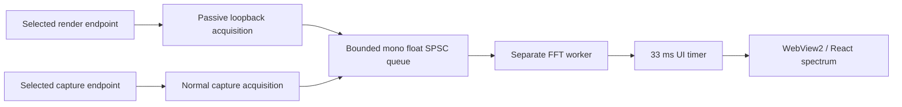

# Native FFT spectrum analyzer

The live data path is implemented from the WASAPI adapter to the existing
WebView2 bridge and React canvas. Portable native and frontend tests validate
its parts. This Linux workspace cannot build or run the Windows host, so live
WASAPI/WebView2 listening validation remains pending. Browser checks use native
FFT results from generated test signals through a test-only bridge shim; they
are not a Windows listening test.

## Signal and thread ownership

Previously the FFT observed the post-limiter DSP source tap before the render FIFO.
It could not see unrelated playback on the selected output. This checkout's source
list contains render endpoints and its route already uses loopback; there was no
microphone selection path. The existing DSP route and read-only tap are preserved.

Spectrum IPC now reads an independent `AnalyzerCapture` instance:



Only one acquisition mode runs at a time. Output mode validates `eRender` and uses
shared mode with `AUDCLNT_STREAMFLAGS_LOOPBACK | AUDCLNT_STREAMFLAGS_EVENTCALLBACK`.
Input mode validates `eCapture` and uses `EVENTCALLBACK` without loopback. Samples
never enter a render client, DSP chain, or render FIFO. The render thread has no
dependency on this acquisition thread. FFT and IPC execute on separate threads.

Home defaults to the configured output endpoint. Localized source and device
selectors allow input capture and Windows default. Device changes stop and join the
previous acquisition thread, release COM interfaces, stop the FFT worker, and open
the new endpoint. An empty endpoint ID follows Windows default, checked every
500 ms. Endpoint failure retries after 500 ms with stop checks every 20 ms.
Analyzer failures do not stop playback. Device lists refresh on Home mount.

`GetMixFormat` provides the actual rate, channels and encoding. Conversion accepts
float32/64, unsigned PCM8, signed PCM16/24/32, and extensible valid bits left aligned
in PCM containers. Unsupported layouts make only analysis unavailable. All channels
are averaged into fixed 256-sample mono scratch storage without modifying samples.
Silent packets permit null data and produce zeros. No-packet idle sessions receive
zeros after 100 ms so the FFT's release smoothing can reach the floor.

The bounded SPSC queue drops analyzer blocks without waiting. Session generations
prevent stale worker frames after restart. Loopback observes the endpoint's Windows
mix, including other applications, rather than physical DAC or acoustic output.
See Microsoft's [loopback documentation](https://learn.microsoft.com/en-us/windows/win32/coreaudio/loopback-recording).

## FFT, window, and levels

`engine/dsp/analyzer/SpectrumAnalyzer.{h,cpp}` implements an iterative radix-2
Cooley–Tukey FFT, O(N log N), without a new FFT dependency. `SpectrumConfig` defaults
to 2048 samples and supports 1024, 2048, 4096, and 8192 for future native configuration.
There is no new user-facing audio setting or preset parameter.

Preparation allocates history, ordered input, window coefficients, bit-reversal
indices, twiddles, FFT scratch, and magnitude storage. The worker hot path uses
these buffers and fixed-size snapshots, with no per-analysis heap allocation.

Each transform sanitizes nonfinite values in its own scratch, removes the Hann-weighted block
mean, and applies a periodic Hann window:

`w[n] = 0.5 - 0.5 cos(2πn/N)`.

One-sided magnitudes are normalized by the actual window sum, doubled except at
DC/Nyquist, and converted using `20 log10(max(magnitude, 1e-12))`. A bin-centered
full-scale sine reads 0 dBFS peak amplitude; a half-scale sine reads approximately
−6.02 dBFS. Off-bin tones exhibit Hann scalloping. Display values are clamped to
−90…0 dBFS by default. These are spectral peak amplitudes, not band-integrated
power, LUFS, true peak, or calibrated sound-pressure measurements.

## Frequency bins and smoothing

64 display bands have equal logarithmic width from 20 Hz to
`min(20,000 Hz, sampleRate / 2)`. Bands containing FFT bins use the maximum measured
linear magnitude in their range. Sub-resolution bands interpolate neighboring
measured linear magnitudes at the geometric band center; this does not increase
native FFT resolution. At 48 kHz, a 2048 FFT resolves about 23.44 Hz per FFT bin.

Native dB values use elapsed-time exponential attack/release smoothing: 40 ms
attack, 250 ms release by default. The worker targets 60 iterations/second, capped
by configuration at 100. It only analyzes after new samples and a full window;
missed deadlines are skipped instead of producing catch-up FFT bursts. Silence
has a measured floor target and decays naturally, with no fake motion.

## IPC and canvas

The existing 33 ms Win32 telemetry timer drains the latest frame and sends at most
one spectrum event per tick, approximately 30 Hz. Events are additive; existing
requests, settings, profiles, and meter events are unchanged. C++ sends technical
numbers only:

- `spectrum`: sequence, steady-clock millisecond timestamp, FFT size, sample rate,
  frequency bounds, floor, 64 dB bins, compute time, actual analysis update rate,
  dropped sample-block count, and dropped frame count.
- `spectrum.status`: analyzer availability, pause state and input/output source,
  independent of DSP route state.

Frames older than one second are not sent as live telemetry. JSON serialization
and WebView2 calls happen only on the native UI thread.

`SpectrumAnalyzer.tsx` subscribes to those events independently of the existing
peak/RMS React state. It validates payloads and stores the latest frame in a ref;
only status/format changes update component state. A memoized canvas renderer
uses requestAnimationFrame, targeting at most approximately 60 FPS, with a 24 ms
presentation transition. A ResizeObserver caches dimensions and style, and DPR
is capped at 3. Unsupported ResizeObserver environments use a size-check fallback.
After one second without fresh frames, the status becomes unavailable and bars
clear with a 250 ms time constant. Native pause/failure clears the target promptly.
Canvas failure never affects playback. Cleanup cancels animation and subscriptions.

Bar X positions are uniform because their native bands are logarithmic. Frequency
labels use actual logarithmic coordinates; the crowded 10 kHz label is staggered
vertically to avoid overlapping the 20 kHz endpoint on narrower plots.

The old static pattern remains a clearly labeled browser/initial-paused/awaiting-data fallback.
It is hidden only after a validated native FFT frame can be rendered. It never
animates or receives a LIVE label. After a live frame, native paused views clear; unavailable views always clear instead
of pretending to measure sound. Status, accessibility labels, and spectrum/FFT/
dBFS help are localized in en, pt-BR, es, and ja.

## Performance and tests

`SpectrumFrame` instruments FFT/window/bin computation time, observed analysis
cadence, and dropped input/output counters without logging from audio callbacks.
A Release GCC 11 Linux benchmark of 10,000 warmed-up 2048-sample analyses measured
about 0.144 ms CPU and 0.157 ms wall time per analysis. At 60 Hz, that FFT-core CPU
measurement projects to about 0.87% of one core, excluding audio copying,
scheduling, IPC, and drawing. It is not a measured total Windows application CPU
percentage or a guarantee for typical desktops. The 1–2% analyzer target still
needs a Windows workload measurement.

Native tests cover 100/440/1000/5000/10000 Hz sines, dual tones, silence/DC,
Hann amplitude normalization, invalid input/configuration, future FFT sizes,
Nyquist/rate changes, real worker publication, anti-phase stereo, saturation,
session restart with a concurrent UI consumer, and bit-for-bit preservation of
both tap input and the complete DSP output with analysis enabled/overflowed/stopped.
Frontend tests cover native frames, silence, truthful fallback/live states,
stale/unavailable/paused data, rate changes, malformed payloads, canvas failure,
cleanup, logarithmic positions, independent bars, and localized open help/status.

Portable Debug/Release and AddressSanitizer/UndefinedBehaviorSanitizer builds can
be run on Linux. The existing Windows CI workflow builds both configurations and
now includes the analyzer test executable through CMake. Required Windows commands:

```powershell
cmake --build build-windows-vs2026 --config Debug
ctest --test-dir build-windows-vs2026 -C Debug --output-on-failure
cmake --build build-windows-vs2026 --config Release
ctest --test-dir build-windows-vs2026 -C Release --output-on-failure
```

On Windows, validate silence, speech, bass-heavy and normal music, high-frequency
and stereo content through distinct compatible endpoints; check visual frequency
regions, callback tail latency, queue drops, CPU, endpoint loss/restart, and WebView2
failure. Those hardware/listening checks have not been performed in this Linux
workspace. The spectrum alone must not be used to judge DSP sound quality.

## Output loopback validation status

Windows compilation and live playback have **not** been validated in this Linux
workspace. This is not yet a confirmed playback fix. Required Windows checks:
microphone speech; speakers with YouTube; headphones with Spotify; pause-to-floor
decay; Speakers → Headphones switching; default endpoint changes; unplug/replug
recovery; idle silence without animation; playback continuing if analysis fails.
Compare output with analysis disabled to confirm unchanged playback.

Added tests cover PCM/float conversion, surround averaging, silent null packets,
source preservation, UI input/output routing, endpoint changes and analyzer-only
stop/start commands. Windows COM lifecycle tests and live validation remain pending.

## Stability follow-up: implementation and evidence

The starting checkout already contained `AnalyzerCapture`, input/output selectors,
format conversion, the bounded analyzer queue, and output loopback. This change
hardens that implementation; it does not replace the FFT or introduce another
playback route. The original post-limiter-only observation defect is documented
above. A particular Windows driver's remaining failure cannot be diagnosed from
this Linux checkout without a live endpoint test.

The lifecycle is now explicit:

- `stopped` → `starting` → `running` on successful selection.
- Loss of a running endpoint or FFT-worker failure enters `recovering`.
- Failed initialization/retry enters `unavailable`; retries continue every 500 ms.
- A default-endpoint change releases the old capture session and enters
  `recovering` before resolving the current default.
- Explicit selections always retry the same ID. They never silently fall back to
  default. Reconnecting that endpoint can resume acquisition.
- Stop requests join acquisition, release capture resources, stop/join the FFT
  worker, then publish `stopped`. Source switching performs stop before start.

The host's existing `IMMNotificationClient` is reused. Device notifications request
an analyzer endpoint check and refresh the input/output selector lists. Acquisition
handles this request itself, within its existing 20 ms wait cadence; callbacks do
not open or release capture sessions. Default notifications now include input
endpoints. Periodic 500 ms checks remain as a fallback, including an explicit
`IMMDevice::GetState` check for disconnected/disabled endpoints. The existing DSP
route's separate device-loss handling is retained.

All sessions still use `GetMixFormat`, shared mode, event callbacks, and loopback
only for `eRender`. Formats remain float32/64 and PCM8/16/24/32 (including
extensible valid bits), at the endpoint rate. No resampling or playback format
change is introduced. The mono signal is the arithmetic mean of all channels,
including LFE for multichannel endpoints. This bounds gain for normalized inputs
but can cancel anti-phase channels; it is a visualization mix, not a speaker
remix. Silent packets and idle sessions feed zeros. The existing preallocated
SPSC queue drops new analyzer blocks when full; acquisition never waits for FFT
or UI. The FFT, windowing, dBFS, logarithmic bands and smoothing are unchanged.

`spectrum.status` adds technical `status`, `sampleRate`, `channels`, and
`acquisitionCpuMs` fields while preserving `source`, `available` and `paused`.
Status is published on state changes and otherwise at most once per second.
`acquisitionCpuMs` is cumulative user+kernel CPU time for the acquisition thread,
queried with `GetThreadTimes`; it resets when a new acquisition thread starts,
not on internal session retries. Compare counter deltas over elapsed wall time
for acquisition CPU usage. Existing spectrum frames retain FFT compute wall time,
observed update rate and dropped block/frame counters. FFT compute wall time is
**not** a measurement of total FFT-thread CPU. Windows acquisition/FFT CPU and
playback impact measurements are still pending; no CPU percentage is claimed.

React translates lifecycle state in en, pt-BR, es and ja. Reconnecting and
unavailable views clear their target. The independent native endpoint view does
not show illustrative bars while awaiting its first real frame. Browser preview
retains its explicitly labeled static illustration. Status for another source is
ignored. Analyzer failures and UI disconnects never call a render interface or
change the DSP profile.

### Validation in this workspace

- Frontend production build: passed.
- Default `npm run test`: 46 passed, one help integration test hit its 5-second
  timeout. `npm run test -- --maxWorkers=1 --testTimeout=15000`: all 47 passed.
- Added a Catch2 case for pinned/default endpoint recovery decisions and failure
  transitions, and a React case for recovery, empty initial native bars, source
  filtering, and return to measured live data.
- CMake/native suite rebuild: unavailable (`cmake` is not installed, and cached
  Catch2 source headers are absent). Newly added Catch2 tests have not run in the
  project runner.
- Fresh focused C++ checks compiled directly with GCC in debug and `-O3` modes:
  passed recovery decisions, 44.1/48/96 kHz worker acquisition, stereo averaging,
  input preservation, null silent packets, queue overflow, and clean worker stop.
  This temporary portable harness does not exercise Windows COM/WASAPI.
- Existing cached Debug executables passed 11 DSP and 12 spectrum cases. These
  binaries predate this change and are baseline evidence only.
- Visual Studio 18 2026 Debug/Release builds and CTest: not run; Windows toolchain
  and hardware are unavailable here.
- Windows 11 manual tests A–I: **all pending**, including real microphone/playback,
  pause decay, bass response, explicit endpoint routing, switching, unplug/replug,
  default changes, and clean application shutdown. Also measure CPU/drop counters
  during playback and UI failure, and compare audio with analysis stopped.

Diff review: nothing under `engine/dsp/` changed. Playback routing, render code,
limiter, EQ, DSP samples, presets and volume were not modified. This is a source
inspection result; listening/physical-output equivalence is not yet verified.
No other roadmap feature was implemented. The feature must remain marked
**awaiting Windows validation**, not production complete.
